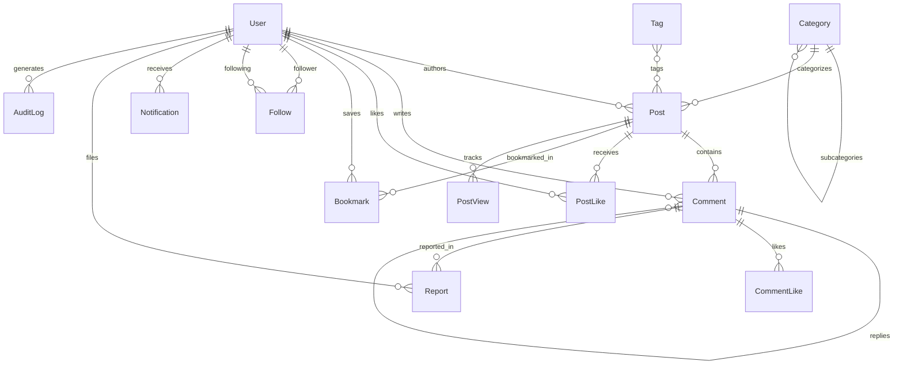

# BlogSphere Architecture & Design Specifications

## 1. System Overview

BlogSphere is engineered using a decoupled, production-grade architecture combining **Django REST Framework** with modern **React 18** and **Vite**:

```
                       ┌─────────────────────────┐
                       │     REACT FRONTEND      │
                       │ Vite • Context • Axios  │
                       │ Modern CSS Design System│
                       └────────────┬────────────┘
                                    │
                               REST / JSON
                                    │
                       ┌────────────▼────────────┐
                       │      DJANGO BACKEND     │
                       │ Django 5 • REST Framework│
                       │ SimpleJWT • CORS        │
                       └────────────┬────────────┘
                                    │
         ┌──────────────────────────┼──────────────────────────┐
         │                          │                          │
   ┌─────▼──────┐             ┌─────▼──────┐             ┌─────▼──────┐
   │  Database  │             │ AI Engine  │             │ Media/File │
   │ PostgreSQL │             │ Heuristics │             │ Storage    │
   │ / SQLite   │             │ & LLM API  │             │ Storage    │
   └────────────┘             └────────────┘             └────────────┘
```

---

## 2. Database Entity Relationship Diagram



---

## 3. Role-Based Access Control (RBAC) Matrix

| Resource / Action | ADMIN | MODERATOR | AUTHOR | USER (Reader) | Guest |
|---|---|---|---|---|---|
| View Published Posts & Comments | ✅ | ✅ | ✅ | ✅ | ✅ |
| Like / Bookmark / Follow | ✅ | ✅ | ✅ | ✅ | ❌ |
| Post Comments & Nested Replies | ✅ | ✅ | ✅ | ✅ | ❌ |
| Create & Publish Posts | ✅ | ❌ | ✅ | ❌ | ❌ |
| Edit & Delete Own Posts | ✅ | ❌ | ✅ | ❌ | ❌ |
| Pin Comments on Own Posts | ✅ | ❌ | ✅ | ❌ | ❌ |
| Author Analytics Studio | ✅ | ❌ | ✅ | ❌ | ❌ |
| File Moderation Report | ✅ | ✅ | ✅ | ✅ | ❌ |
| Review & Resolve Reports | ✅ | ✅ | ❌ | ❌ | ❌ |
| Suspend Users / Remove Content | ✅ | ✅ | ❌ | ❌ | ❌ |
| Change User Roles / Deactivate | ✅ | ❌ | ❌ | ❌ | ❌ |
| View Security Audit Logs | ✅ | ✅ | ❌ | ❌ | ❌ |

---

## 4. Security Architecture

1. **Authentication**: Stateless HMAC-SHA256 JWT tokens via `djangorestframework-simplejwt`. Short-lived access tokens with rotating refresh tokens and automated frontend interceptor renewal.
2. **Password Protection**: Multi-round PBKDF2 with SHA-256 password hashing.
3. **Authorization**: Custom DRF permission classes (`IsAuthorOrAdminOrReadOnly`, `IsModeratorOrAdmin`).
4. **CORS & CSRF**: Dedicated CORS headers allowing frontend dev proxy and production domains with strict header allowlisting.
5. **View Throttling**: IP-based rate limiting on anonymous endpoints and authenticated user ceilings.
6. **Input Sanitization**: ORM parameterized SQL query execution preventing SQL injections, slugification, and markdown escaping.
